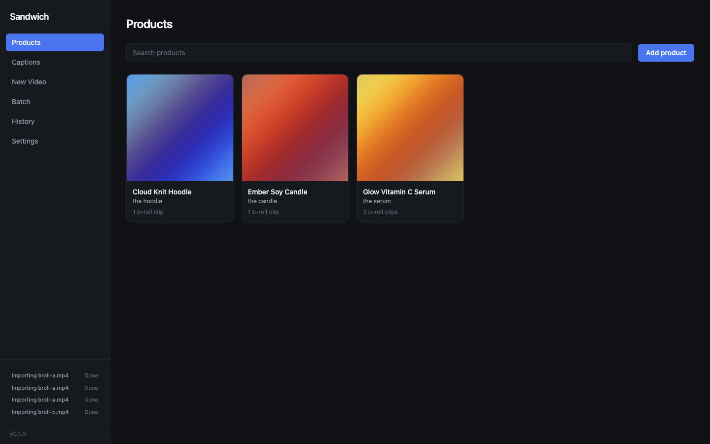
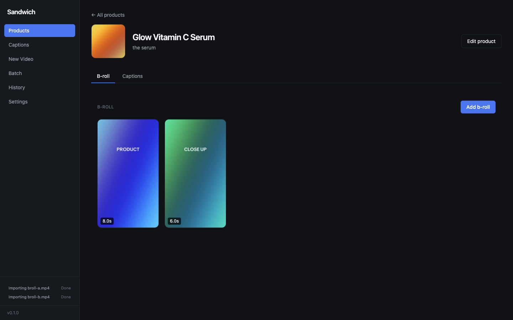
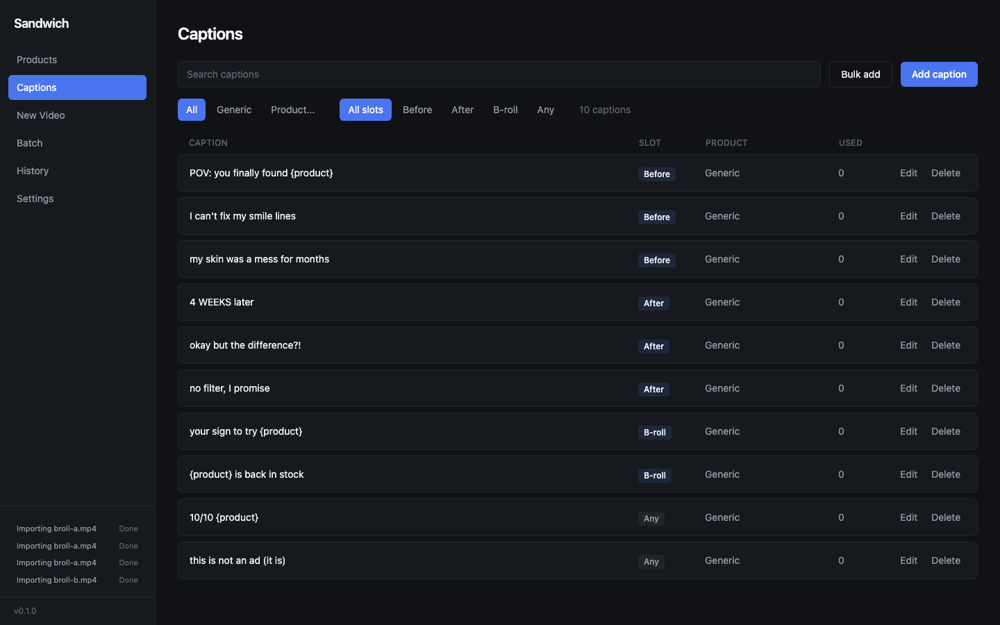
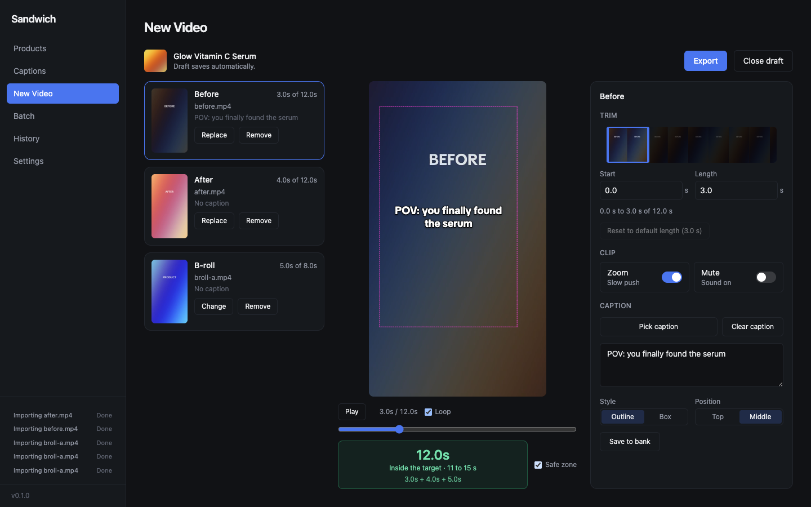
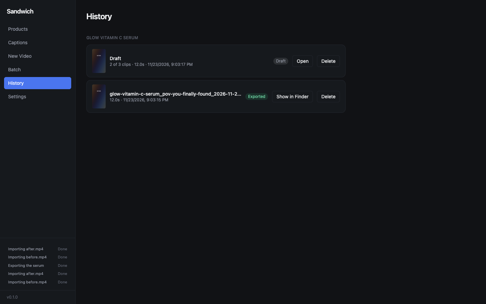
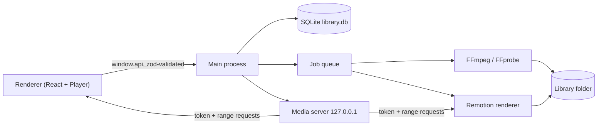
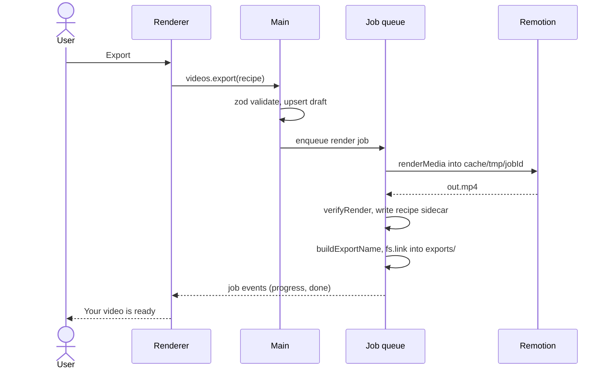

<div align="center">

# Sandwich

**A desktop editor that turns raw UGC clips into finished 9:16 TikTok Shop videos, using one fixed before, after and product b-roll template.**


</div>

<!-- TODO: record this -->


**Tech:** TypeScript · Electron · React 19 · Remotion · FFmpeg · SQLite · Zustand · Tailwind

---

## Overview

Making a TikTok Shop video from creator footage is the same chore every time. The clips arrive as HDR iPhone files, rotated, at variable frame rates, in a camera roll folder. Someone has to find the right before and after clips, trim them, pick a product b-roll clip, type a caption that stays clear of TikTok's buttons, export, and name the file so it can be found later.

Sandwich does that with one template: a **Before** clip, an **After** clip and a **B-roll** clip of the product. Each slot gets a trim, an optional zoom, an optional caption and a mute switch. Products, their b-roll and a caption bank live in a local library, so the repeated parts are one click. I'm building it with a partner who will be the second user. The manual-mode MVP (phases 0 to 3 in `docs/ROADMAP.md`) is built; batch mode is next. Music is added later in the TikTok app, so the app doesn't handle it.

## Features

**Every clip is made safe on import.** Imports are probed with FFprobe, then normalized to SDR H.264 at constant 30 fps with rotation baked in, plus a thumbnail and a filmstrip for trimming. HDR (HLG and PQ) is tone mapped, so iPhone clips don't come out grey.

**Products carry their own b-roll and captions.** Each product has a photo, a short name and a b-roll library. Hovering a b-roll tile plays a muted preview, and a caption can use `{product}` or `{full}` so one line works for every product.

**Trimming works like an Instagram story.** A window slides along a filmstrip, its edges resize it, and the arrow keys nudge it by 0.1 second. The preview and a length indicator show whether the video lands in the 11 to 15 second target.

**The preview is the export.** The editor plays the same `<SandwichVideo>` composition that the exporter renders, with a safe-zone overlay for TikTok's buttons. What you see is what gets written to disk.

**Exports are named, verified and recorded.** Each video is checked against the output spec before it appears in `exports/`, and a `.recipe.json` sidecar sits next to it. History lists drafts, exports and failures grouped by product.

## Results

- 977 unit tests across 82 files, plus 10 Playwright specs that drive the packaged app
- A 12 second render takes about 1 second per output second on an M2 Pro (measured, `docs/reference/DECISIONS.md` #27)
- Tone mapping tuned against Apple's own HDR to SDR conversion of the same clip: SSIM 0.9904 versus 0.9795 for the first settings I tried (#24)
- Colour fidelity of a render against its source clip: 2.2 out of 255 difference, against a 5 out of 255 limit (#27)

## Tech Stack

| Layer | Technology | Notes |
| ----- | ---------- | ----- |
| Shell | [Electron](https://www.electronjs.org/) with [Electron Forge](https://www.electronforge.io/) and [Vite](https://vite.dev/) | Main process owns files, SQLite, FFmpeg and rendering. The UI talks to it through a typed preload API. |
| UI | [React](https://react.dev/) 19, [Tailwind CSS](https://tailwindcss.com/) | Feature folders under `src/renderer/features/`. |
| State | [Zustand](https://zustand.docs.pmnd.rs/) | The editor store holds the current recipe draft and autosaves it. |
| Language | [TypeScript](https://www.typescriptlang.org/) (strict) | Shared logic in `src/shared/` has no Node or DOM imports. |
| Preview and render | [Remotion](https://www.remotion.dev/) 4.0.535 | `@remotion/player` for preview, `@remotion/renderer` in main for export. Every package is pinned to one version. |
| Media tools | [FFmpeg](https://ffmpeg.org/) and FFprobe | Bundled binaries: probe, normalize, thumbnails, filmstrips. |
| Database | [SQLite](https://www.sqlite.org/) via [better-sqlite3](https://github.com/WiseLibs/better-sqlite3) | Numbered SQL migrations, paths stored relative to the library root. |
| Validation | [Zod](https://zod.dev/) | The recipe schema and every IPC payload. |
| Tests | [Vitest](https://vitest.dev/), [Playwright](https://playwright.dev/) | Vitest for logic, Playwright in Electron mode for smoke tests. |

## Screenshots

**Products:** Each card shows the photo, short name and b-roll count.


**Product b-roll:** Imported clips get thumbnails and duration badges.


**Caption bank:** Captions are tagged by slot and product, and `{product}` fills in per video.


**Editor:** Trim, zoom, mute and caption controls beside a live preview with the safe zone on.


**History:** Drafts and exports grouped by product.


The screenshots use synthetic demo clips generated by `npm run readme:media`, not real creator footage.

## Architecture



The Player in the UI and Remotion's headless browser both load clips by URL from one small local media server, so preview and export read the same files the same way.

## Engineering Decisions

**Normalizing every clip on import, and tuning HDR against a reference.** UGC arrives as HDR HEVC, rotated, at variable frame rates. Handling each of those at preview and render time would spread colour and sync bugs across the app. Instead `src/main/media/normalize.ts` converts every import once to SDR H.264, 30 fps constant, with the arguments built in `src/shared/ffmpegArgs.ts`. My first tone map setting (`hable`, `npl=100`) came out about 14% too bright. I compared variants against Apple's own conversion of the same clip using `npm run normalize -- <clip> <out.mp4> --tonemap-variants`, and landed on `npl=180`. The setting is one curve fitted to a single HLG clip, and the decision log says to re-check it on more footage.

**Tagging the render as Rec.709 and checking the pixels.** Remotion's default output was tagged `color_space=unknown` with an sRGB transfer, and converted with the BT.601 matrix. Relabelling the file would not have fixed the pixels. `renderRecipe()` in `src/main/render/render-recipe.ts` passes `colorSpace: "bt709"` so the conversion itself changes. `verifyRender` in `src/main/render/verify.ts` then checks the output spec, faststart and the colour fidelity of one patch against its source. A correct render differs by 2.2 and the same render decoded with BT.601 tags by 6.7, so the limit is 5, not the 8 I first planned.

**Rendering in a temp folder and linking the result in.** A render that crashes or fails verification must not leave a half-written file in `exports/`, or burn a file name. The `render` job in `src/main/render/exportVideo.ts` builds the mp4 and its sidecar in `cache/tmp/<jobId>/`, verifies it, and only then picks the name with `buildExportName`. Files go into place with `fs.link`, because `fs.rename` would silently overwrite an existing export on macOS. Filesystems without hard links fall back to `copyFile` with `COPYFILE_EXCL`, and a lost name race re-picks the name. A same-day export with the same hook becomes `_02`, never a replacement.

**One composition for preview and export.** If the Player and the exporter drew captions and zoom separately, they would drift apart and the preview would lie. `remotion/SandwichVideo.tsx` is used by both. Each video is a `Recipe` JSON (`src/shared/recipe.ts`), the UI only edits recipes and the renderer only reads them. `calculateMetadata` derives the duration from `buildTimeline`, and caption layout comes from `computeCaptionLayout`, so the same numbers drive both. The cost is that the composition has to work in two environments, which is why `ClipLayer.tsx` falls back to an HTML5 video inside the Player (#26).

**Serving local video over a token-guarded HTTP server.** Both the Player in the UI and Remotion's headless browser need to load local video by URL, and scrubbing needs range requests. `src/main/media/mediaServer.ts` binds to `127.0.0.1` on a random port, with a random per-session token in the URL. Paths are split and checked segment by segment on the raw request target, because a parsed URL would collapse `..` before the check. `src/main/media/pathGuard.ts` then compares `realpath`s so symlinks cannot escape the library.

## What's Next

- Batch mode: the sidebar entry exists, and the pure logic for pairing and the shuffle bag is already in `src/shared/pairing.ts` and `src/shared/shuffleBag.ts`, so the work is the intake screens and the pairing board.
- A render queue with cancel, retry and notifications, building on the existing job scheduler (`src/shared/jobScheduler.ts`).
- A Windows build. Paths already go through `path.join`, binaries are spawned with argument arrays, and media paths in the DB are relative, so what remains is packaging and CI.
- Real use: the MVP's exit test is three real videos posted as TikTok drafts, then a week of use by my partner.

<details>
<summary><b>Technical deep dive</b></summary>

**Core mechanic:** A video is a `Recipe` JSON with three slots. The editor edits it, the Player previews it, and `renderMedia` turns it into an mp4 using the same composition.

### Export sequence



### Architecture notes

- **The main process owns everything with side effects.** The renderer only reaches it through the typed `window.api` in `src/preload/preload.ts`, with `contextIsolation`, `sandbox` and no `nodeIntegration`. There is no generic `invoke(channel)` passthrough.
- **Shared logic is pure.** `src/shared/` has no `fs` or `window`, and everything in it is unit tested. The job scheduler takes closures as runners, so tests use fake ones.
- **Jobs are bounded.** `importClip` runs two at a time and `render` one at a time, in separate pools. A cancelling job keeps its slot until its child process has closed, so a cancel can never start a third FFmpeg.
- **Import outputs are staged.** Files are built in `cache/tmp/<jobId>/` and renamed into place, and the database row is inserted last. `sweepLibrary` empties the staging folder on the next open.
- **Original files are never touched.** FFmpeg opens the original read-only, and the library only holds the normalized copy. Media paths in the database are relative to the library root.
- **Exports are verified in two tiers.** Hard rows (size, fps, codec, `yuv420p`, Rec.709 tags, AAC 48 kHz stereo, faststart) fail the export. Soft rows (per-clip audio, colour fidelity) become warnings, since they are heuristics that can false-fail on handheld footage.
- **Failed rows are not dead ends.** Saving a failed draft revives it, so a failed export never strands the user's work.
- **Binaries live outside `app.asar`.** FFmpeg, the Remotion compositor and the headless browser sit in `app.asar.unpacked`, with explicit `binariesDirectory` and `browserExecutable` paths passed in.

### Project structure

```text
sandwich/
├── src/
│   ├── main/            # Electron main: IPC, db, jobs, media (ffmpeg), render, media server
│   ├── preload/         # typed bridge exposing window.api
│   ├── renderer/        # React UI, one folder per feature under features/
│   └── shared/          # zod schemas and pure logic (recipe, naming, pairing, timeline)
├── remotion/            # Remotion root and the <SandwichVideo> composition
├── scripts/             # fixtures, render CLI, verify, probe, normalize, README capture
├── tests/               # Vitest unit tests; e2e/ holds Playwright specs
├── docs/                # roadmap, checklist, user guide; reference/ has SPEC, ARCHITECTURE, DECISIONS
├── assets/fonts/        # bundled caption font and its license
└── forge.config.ts      # packaging: asar unpack rules, prebuilt Remotion bundle, browser
```

### Security

| Mechanism | Where |
| --------- | ----- |
| Per-session random token in every media URL, compared in constant time | `src/main/media/mediaServer.ts` |
| Path traversal blocked on the raw request, then `realpath` containment | `src/shared/mediaPath.ts`, `src/main/media/pathGuard.ts` |
| Server bound to `127.0.0.1` only | `src/main/media/mediaServer.ts` |
| Renderer isolation: `contextIsolation`, `sandbox`, no `nodeIntegration` | `src/main/main.ts` |
| Every IPC payload validated with zod | `src/main/ipc/` |
| Delete-with-files only trashes paths inside `<library>/exports/` | `src/main/videos/videoService.ts` |
| Media token redacted from every log line, renderer-sent text included | `src/shared/logRotate.ts`, `src/main/log/logger.ts` |
| Warning when the library folder is inside a synced folder | `src/main/library/inspectFolder.ts` |

### Library layout

```text
SandwichLibrary/
├── library.db
├── products/<productId>/     # image.jpg, broll/<id>.mp4 and thumbnails
├── clips/<yyyy-mm>/          # normalized UGC clips and thumbnails
├── cache/                    # filmstrips and tmp staging
└── exports/<product>/<date>/ # <name>.mp4 and <name>.recipe.json
```

</details>

<details>
<summary><b>Run it locally</b></summary>

### Prerequisites

- Node.js 22
- macOS on Apple Silicon (FFmpeg and the Remotion compositor are fetched for `darwin-arm64`; Windows resolves in code but is not built yet)

### Setup

```bash
git clone https://github.com/ar1shah/sandwich.git
cd sandwich
npm install        # postinstall downloads pinned, hash-checked FFmpeg into vendor/
npm run fixtures   # optional: generates test media in fixtures/
npm run dev
```

### Required env var names

- `SANDWICH_USER_DATA` (optional): overrides the Electron user data folder, used by the e2e tests and for fresh-launch checks

### Useful scripts

| Script | Command |
| ------ | ------- |
| `npm test` | Vitest unit tests |
| `npm run lint` | ESLint plus `tsc --noEmit` |
| `npm run make` | Package the app into `out/` |
| `npm run test:e2e` | Playwright smoke tests against the packaged app (run `make` first) |
| `npm run studio` | Remotion Studio on the Sandwich composition with the sample recipe |
| `npm run render:sample` | Render `fixtures/sample.recipe.json` to `out/sample.mp4` |
| `npm run verify:render -- <file.mp4>` | Check a render against the output spec |
| `npm run probe -- <file>` | Print the probe result for a video |
| `npm run normalize -- <in> <out.mp4>` | Normalize one clip, with thumbnail and filmstrip |
| `npm run ffmpeg:check` | Report FFmpeg capabilities, fail if a required filter is missing |
| `npm run readme:media` | Regenerate the README screenshots from the packaged app |

</details>

---

Sandwich is a desktop app, so there is no live demo. It is in development, and the screenshots above are the best look at it.

Ari Shah · [Portfolio](https://www.ar13.dev/) · [LinkedIn](https://linkedin.com/in/arishah)
